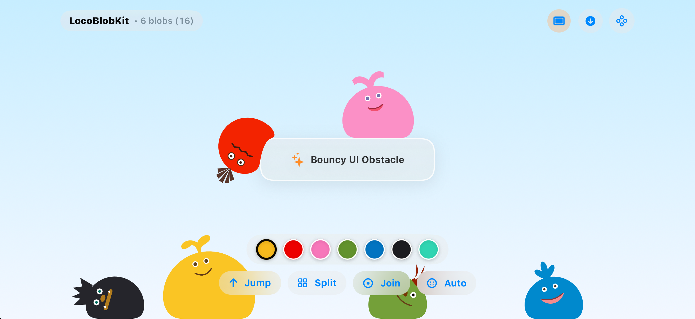

<p align="center">
  
</p>

<p align="center">
  <strong>Squishy, interactive LocoRoco-style soft-body blobs for any iOS & macOS app.</strong>
</p>

<p align="center">
  
  
  
  
</p>

<p align="center">
  
</p>

---

## Highlights

- **Authentic Soft-Body Physics (`LocoBlob` & `LocoBlobWorld`)** — 60 Hz Verlet integration with a complete-graph ($K_N$) spring-mass ring (`8` / `16` / `32` perimeter vertices), area-preserving radius scaling, anti-collapse & mirror-unfolding anti-inversion guards, splitting, and contour-stitching merges.
- **Drop-In Transparent SwiftUI View (`LocoBlobView`)** — Float squishy blobs over or behind any SwiftUI layout with built-in touch drag, fling, poke, double-tap-to-split, and optional **CoreMotion gyroscope tilt**.
- **Collide with Real UI Elements (`LocoBlobObstacle`)** — Pass rectangles, circles, or capsules (even live SwiftUI cards & buttons) and watch blobs squash and bounce off them.
- **6 Classic Characters + Full Custom Styling (`LocoBlobAppearance`)** — Includes **Kulche**, **Pekerone**, **Priffy**, **Chavez**, **Tupley**, and **Budzi** with blinking eyelids, velocity gaze tracking, swaying hair tufts, and dynamic expressions (`neutral`, `jumping`, `singing`, `scared`, `excited`, `squashed`) — or create custom brand-colored or faceless blobs.
- **Render Anywhere** — Pure CoreGraphics (`LocoBlobRenderer`) for SwiftUI `Canvas` / `CALayer` / bitmaps, plus a ready-to-use SpriteKit `SKNode` (`LocoBlobNode`).

---

## Installation

### Xcode (Swift Package Manager)
1. Open your Xcode project and choose **File → Add Package Dependencies…**
2. Paste the repository URL:
   ```text
   https://github.com/Arafo/LocoBlobKit.git
   ```
3. Add **LocoBlobKit** to your app target and `import LocoBlobKit`.

### `Package.swift`
```swift
dependencies: [
    .package(url: "https://github.com/Arafo/LocoBlobKit.git", from: "1.0.0")
]
```

---

## Quick Start (SwiftUI — 1 Line)

Drop interactive, transparent squishy blobs into any view:

```swift
import SwiftUI
import LocoBlobKit

struct ContentView: View {
    var body: some View {
        ZStack {
            LinearGradient(colors: [.cyan.opacity(0.25), .white], startPoint: .top, endPoint: .bottom)
                .ignoresSafeArea()

            LocoBlobSandboxView(
                blobs: [
                    .init(appearance: .kulche, size: 4),
                    .init(appearance: .priffy, size: 3),
                    .init(appearance: .tupley, size: 2)
                ],
                enableGyroscope: true
            )
        }
    }
}
```

---

## Programmatic Control (`LocoBlobController`)

Hold a `@State` controller to spawn blobs, jump, split, join, toggle zero-G, or drive facial expressions:

```swift
struct MyInteractiveView: View {
    @State private var blobs = LocoBlobController(
        blobs: [.init(appearance: .kulche, size: 5)],
        enableGyroscope: true
    )

    var body: some View {
        ZStack(alignment: .bottom) {
            LocoBlobView(controller: blobs)

            HStack(spacing: 10) {
                Button("Spawn") {
                    blobs.spawn(LocoBlobAppearance.classicCast.randomElement()!, size: 3)
                }
                Button("Jump") { blobs.jump() }
                Button("Split") { blobs.splitAll() }
                Button("Join") { blobs.setJoining(!blobs.world.isJoining) }
            }
            .buttonStyle(.borderedProminent)
            .padding()
        }
    }
}
```

---

## Custom Brand Blobs & UI Obstacles

```swift
// Custom color with any hair or face style (use `.none` for a pure organic soft-body blob)
let mintBlob = LocoBlobAppearance.custom(
    color: LocoRGBAColor(r255: 48, g255: 213, b255: 178),
    hair: .tupley,
    face: .kulche
)
blobs.spawn(mintBlob, size: 4)

// Collide against SwiftUI view-space rects (e.g., floating cards or buttons)
blobs.setViewSpaceObstacles([cardRect], in: containerSize, isBouncy: true)

// Or define world-space obstacles directly
blobs.world.obstacles = [
    .rect(CGRect(x: 20, y: 30, width: 45, height: 10)),
    .circle(center: CGPoint(x: 90, y: 40), radius: 12, isBouncy: true, bounceFactor: 1.3),
    .capsule(from: CGPoint(x: 10, y: 15), to: CGPoint(x: 60, y: 28), thickness: 2.5)
]
```

---

## SpriteKit Usage (`LocoBlobNode`)

```swift
import SpriteKit
import LocoBlobKit

let world = LocoBlobWorld(bounds: CGRect(x: 0, y: 0, width: 150, height: 100))
let blob = world.spawnBlob(size: 3, appearance: .chavez)
let node = LocoBlobNode(blob: blob)
scene.addChild(node)

// Inside your fixed 60 Hz update loop:
world.stepFixedFrame()
node.sync(with: blob)
```

---

## Cast & Customization

| Preset | Character | Hair Style | Signature Features |
| :--- | :--- | :--- | :--- |
| `.kulche` | **Kulche** (Yellow) | `.kulche` | Twin-lobe sprout & warm smile |
| `.pekerone` | **Pekerone** (Red) | `.pekerone` | Dark 5-petal fan crest & zig-zag grin |
| `.priffy` | **Priffy** (Pink) | `.priffy` | Twin ribbon wings & rosy lips |
| `.chavez` | **Chavez** (Green) | `.chavez` | Crimson grass tuft, iris ring & teardrop nose |
| `.tupley` | **Tupley** (Blue) | `.tupley` | 3-petal clover sprout & chubby coral lips |
| `.budzi` | **Budzi** (Black) | `.budzi` | Spiky crown, snout & tiny white underbite fangs |
| `.custom(...)` | **Any** | Any / `.none` | Custom body color, optional face & hair |

---

## Architecture

```text
LocoBlobKit/
├── Package.swift
├── Assets/
│   ├── locoblobkit-icon.png
│   ├── locoblobkit-logo.png
│   └── demo-preview.png
├── Examples/
│   └── LocoBlobKitDemo/              # Interactive SwiftUI 6.0 iOS playground app
├── Sources/LocoBlobKit/
│   ├── Core/
│   │   ├── LocoBlobConstants.swift   # Exact 60 Hz soft-body constants
│   │   ├── LocoBlobAppearance.swift  # 6 classic presets + custom styling
│   │   ├── LocoBlob.swift            # Verlet + K_N spring-mass ring, split & merge
│   │   ├── LocoBlobObstacle.swift    # Capsule, circle & rect collision shapes
│   │   └── LocoBlobWorld.swift       # Multi-blob solver, tilt, drag/fling & poke
│   ├── Rendering/
│   │   ├── LocoBlobRenderer.swift    # Pure CoreGraphics vector renderer
│   │   └── LocoBlobNode.swift        # SpriteKit SKNode wrapper
│   └── SwiftUI/
│       ├── LocoBlobController.swift  # SwiftUI controller + CoreMotion gyro bridge
│       └── LocoBlobView.swift        # Drop-in transparent interactive SwiftUI view
└── Tests/LocoBlobKitTests/
    └── LocoBlobKitTests.swift
```

---

## Running Tests & Demo App

```bash
# Run unit tests (macOS SwiftPM)
swift test
```

Open `Examples/LocoBlobKitDemo/LocoBlobKitDemo.xcodeproj` in Xcode to run the interactive iOS playground shown above.
